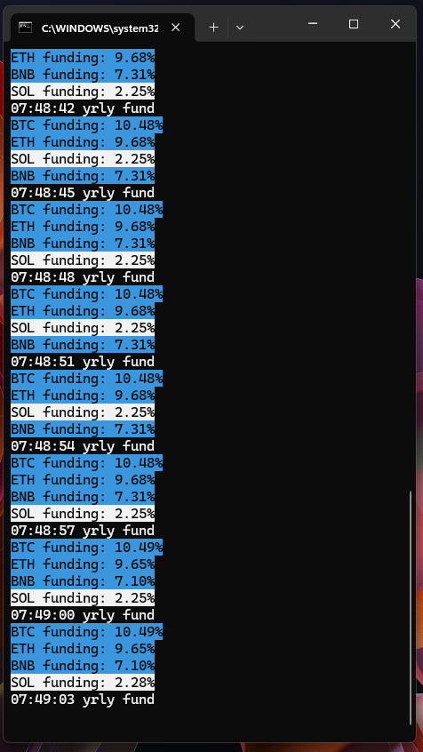

# Binance Live Trades Feed

A real-time crypto market monitoring project built with Python and Binance Futures WebSocket streams.

The project connects to live Binance market data, processes trades asynchronously across multiple symbols, and surfaces large trade activity and funding-rate information in the terminal.

## Overview

This repository contains three notebook-based monitoring tools:

- **Recent Trades** - streams individual large trades and highlights them by trade size.
- **Huge Trades** - aggregates trades into one-second buckets to identify unusually large buy or sell activity.
- **Funding** - monitors perpetual-futures funding rates and displays an annualised equivalent.

The project was built to explore asynchronous programming, WebSockets, live market-data processing and simple market microstructure signals.

## Tech Stack

- Python
- asyncio
- WebSockets
- Binance Futures WebSocket API
- JSON
- pytz
- termcolor
- Jupyter Notebook

## Tracked Markets

The trade feeds currently monitor a selection of USDT perpetual futures, including:

- BTC
- ETH
- SOL
- BNB
- DOGE
- WIF

The funding notebook currently monitors BTC, ETH, SOL and BNB.

## 1. Recent Trades

**Notebook:** `recent_trades.ipynb`

Connects to Binance `aggTrade` streams and processes live trades concurrently across multiple symbols.

For each trade, the notebook:

1. Receives the trade message over WebSocket.
2. Parses price, quantity, timestamp and maker-side information.
3. Calculates the approximate USD notional value as:

```text
trade value = price × quantity
```

4. Filters out trades below $15,000.
5. Classifies the trade as BUY or SELL using Binance's buyer-maker flag.
6. Applies stronger terminal highlighting as trade size increases.
7. Appends qualifying trades to `binance_trades.csv`.

Current display thresholds:

| Trade value | Display behaviour |
|---|---|
| $15,000 - $49,999 | Standard highlighted trade |
| $50,000 - $99,999 | Bold, highlighted twice |
| $100,000+ | Bold, highlighted three times |

Example output:


## 2. Huge Trades

**Notebook:** `huge_trades.ipynb`

This feed looks for larger bursts of market activity rather than displaying every qualifying trade individually.

Trades are aggregated into one-second buckets using:

- symbol
- second
- buy/sell side

The aggregated notional value is then evaluated once the time bucket is complete.

Current logic:

- buckets above **$500,000** are displayed
- buckets above **$3,000,000** receive stronger visual emphasis
- buy and sell flow are displayed separately

This makes it easier to identify bursts of concentrated trading activity that may be spread across several individual trades.

Example output:


## 3. Funding Monitor

**Notebook:** `funding.ipynb`

Connects to Binance `markPrice` streams and reads the current funding rate for each tracked perpetual futures contract.

The notebook converts the periodic funding rate into a simple annualised equivalent:

```text
annualised funding (%) = funding rate × 3 × 365 × 100
```

This assumes three funding periods per day and is intended as a monitoring approximation rather than a forecast of realised annual funding.

Funding values are colour-coded by magnitude so unusually high positive or negative funding can be identified quickly.

Example output:



## How It Works

Each market is handled as an asynchronous task.

```text
Binance Futures WebSocket
          |
          v
   Live JSON messages
          |
          v
   Async Python streams
          |
          +--------------------+
          |                    |
          v                    v
   Trade processing      Funding processing
          |
          v
 Filtering / aggregation
          |
          v
 Terminal output + CSV logging
```

Using `asyncio.gather()` allows multiple symbol streams to run concurrently without creating a separate process for each market.

## Installation

Clone the repository:

```bash
git clone https://github.com/getredportfolio/binance_live_trades_feed.git
cd binance_live_trades_feed
```

Install the required packages:

```bash
pip install websockets pytz termcolor jupyter
```

Then start Jupyter:

```bash
jupyter notebook
```

Open one of the notebooks and run its cells.

## Running in Jupyter

These notebooks use asynchronous code.

Some Jupyter environments already have an active event loop, which means calling:

```python
asyncio.run(main())
```

may raise:

```text
RuntimeError: asyncio.run() cannot be called from a running event loop
```

When that happens, run the coroutine directly from a notebook cell instead:

```python
await main()
```

When the same code is moved into a standalone Python script, `asyncio.run(main())` is appropriate.

## Data Source

The project uses Binance Futures public WebSocket streams.

The current implementation uses:

- `@aggTrade` for aggregated trade data
- `@markPrice` for mark-price and funding-rate updates

No Binance API key is required for these public market-data streams.

## Output

Depending on the notebook, the project produces:

- real-time terminal output
- highlighted large buy/sell activity
- one-second aggregated trade-flow alerts
- live funding-rate monitoring
- CSV logging of qualifying trades

## Project Structure

```text
binance_live_trades_feed/
|
|-- recent_trades.ipynb
|-- huge_trades.ipynb
|-- funding.ipynb
|-- Recent Trades.png
|-- Huge Trades.png
|-- Funding.png
|-- README.md
```

## What I Learned

This project helped me practise:

- consuming real-time WebSocket APIs
- asynchronous programming with `asyncio`
- running multiple data streams concurrently
- parsing and transforming streaming JSON data
- translating raw exchange fields into useful market signals
- aggregating high-frequency events into time buckets
- basic error handling for persistent data streams
- logging processed market data for later analysis

## Possible Improvements

Future improvements could include:

- moving the core logic from notebooks into reusable Python modules
- automatic WebSocket reconnection and backoff
- configurable symbols and trade-size thresholds
- structured logging
- unit and integration tests
- PostgreSQL or time-series database storage
- Docker support
- a lightweight dashboard for real-time monitoring
- historical analysis of large-trade events and subsequent price movement

## Disclaimer

This project is for educational and research purposes only. It does not provide investment advice or execute trades.
